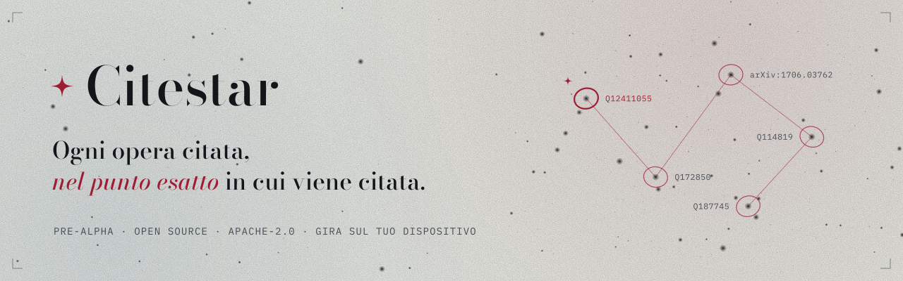

<picture>
  <source media="(prefers-color-scheme: dark)" srcset="docs/assets/banner-it-dark.svg">
  
</picture>

<p>
  <a href="https://github.com/citestar/citestar/actions/workflows/ci.yml"></a>
  &nbsp;<a href="README.md">Read in English</a>
</p>

Citestar riconosce i libri, i paper, i film, le serie, le canzoni, i podcast e i talk nominati in ciò che leggi,
guardi o ascolti, e li mostra nel momento o nella riga in cui compaiono. Gira sul tuo dispositivo, non chiede un
account e resta in disparte.

> [!NOTE]
> **Pre-alpha.** Le basi del core e lo schema dell'Open Citation Track sono pronti (milestone M1b); il
> rilevamento è in costruzione. Non c'è ancora niente di rilasciato.

## Tre momenti

| Prima di cliccare                                                                                                                                                                       | Durante                                                                                                                                                                 | Dopo                                                                                                                    |
| --------------------------------------------------------------------------------------------------------------------------------------------------------------------------------------- | ----------------------------------------------------------------------------------------------------------------------------------------------------------------------- | ----------------------------------------------------------------------------------------------------------------------- |
| Un piccolo numero su un link o una miniatura. Passandoci sopra vedi le opere principali e una linea del tempo con la loro posizione; un punto sulla linea apre il video a quel secondo. | Quando un'opera viene nominata, un bagliore compare sul bordo e si apre nel suo titolo, lontano da sottotitoli e controlli. Niente si mette in pausa, niente fa rumore. | Tutte le citazioni della sessione in un elenco, con la frase da cui vengono, pronte per Zotero, BibTeX, CSL-JSON o RIS. |

## Parla solo quando è sicuro

Una citazione sbagliata costa più di una persa. Una menzione compare solo se il valore atteso di mostrarla è
positivo:

```text
mostra se   p·U − (1 − p)·C_fp − C_att > 0
cioè        p > (C_fp + C_att) / (U + C_fp) = (3 + 0.2) / (1 + 3) = 0.80
```

`p` è la confidenza calibrata, `U = 1` il valore di una citazione utile, `C_fp = 3` il costo di una sbagliata e
`C_att = 0.2` il costo della tua attenzione. Anche il resto del comportamento ha i suoi numeri:

|           |                                                                                                                           |
| --------: | ------------------------------------------------------------------------------------------------------------------------- |
|  **0,80** | Confidenza necessaria per comparire sullo schermo. Tra 0,5 e 0,8 un'opera finisce solo nell'elenco, segnata come "forse". |
|     **2** | Citazioni sullo schermo nello stesso momento, al massimo.                                                                 |
|  **10 s** | Intervallo medio tra un chip e il successivo: un token bucket si ricarica di 0,1 al secondo, fino a 2.                    |
| **1,5 %** | Del player che un chip chiuso può coprire. Aperto al passaggio o al focus, al massimo il 12 %.                            |
|  **6 px** | Ciò che resta a schermo intero: un solo punto di luce.                                                                    |
|     **0** | Pause, suoni e finestre a comparsa.                                                                                       |

Le derivazioni sono in [docs/MATH.md](docs/MATH.md) (in inglese).

## La trascrizione resta tua

| Resta sul tuo dispositivo                             | Esce                                                                                                                               |
| ----------------------------------------------------- | ---------------------------------------------------------------------------------------------------------------------------------- |
| Le pagine che leggi e i sottotitoli di ciò che guardi | La sola menzione, come `Sapiens`, inviata a cataloghi aperti come Wikidata e Open Library                                          |
| La trascrizione dell'audio, mai salvata               | Solo se scegli la cache condivisa: i primi bit di un indirizzo cifrato con hash, a cui il server risponde con almeno altre 50 voci |
| Il rilevamento e il punteggio di ogni menzione        |                                                                                                                                    |
| L'elenco delle opere che salvi                        |                                                                                                                                    |

Nessun account, nessuna telemetria, nessun link di affiliazione.

## Open Citation Track

Creator ed editori possono elencare una volta sola le opere che citano, con il secondo o la frase in cui
compaiono. Citestar si fida di queste tracce più che delle proprie ipotesi e le segna come verificate. Le opere
sono identificate da Wikidata, così lo stesso libro ha la stessa identità in ogni lingua.

```json
{
  "specVersion": "0.1.0",
  "works": [
    {
      "id": "wikidata:Q12411055",
      "type": "book",
      "title": "Sapiens",
      "authors": ["Yuval Noah Harari"],
      "year": 2011
    }
  ],
  "mentions": [
    {
      "surface": "Sapiens",
      "anchor": { "kind": "time", "start": 312.4, "end": 313.6 },
      "workId": "wikidata:Q12411055",
      "p": 0.94,
      "source": "creator"
    }
  ]
}
```

Lo schema in bozza, gli esempi e le regole sono in [spec/](spec/).

## Tabella di marcia

|     | Milestone                                                                                         | Stato              |
| --- | ------------------------------------------------------------------------------------------------- | ------------------ |
| M0  | Ricerca: cataloghi, termini delle piattaforme, prodotti simili, il nome                           | Fatto              |
| M1  | Pipeline di base: rilevamento, collegamento a Wikidata, calibrazione, un gold set di 500 menzioni | **In corso** (M1b) |
| M2  | Interfaccia e demo: chip, card e la costellazione, su articoli, PDF e video                       | Prossimo           |
| M3  | Estensione per Chrome, Edge e Firefox: articoli, PDF, YouTube                                     | In programma       |
| M4  | Riconoscimento vocale sul dispositivo per i video senza sottotitoli; video verticali              | In programma       |
| M5  | Embed in una riga, lo standard pubblicato, una cache self-hosted                                  | In programma       |
| M6  | Lancio: store delle estensioni, documentazione, italiano e inglese                                | In programma       |

## Il repository

```text
packages/core   pipeline senza DOM: modello, normalizzazione, somiglianza, statistiche di calibrazione
spec/           Open Citation Track: JSON Schema, esempi, regole
tools/          build e controlli del repository, asset grafici
docs/           ricerca, decisioni, architettura, matematica
```

Servono Node.js 26 e Corepack. Poi:

```sh
pnpm install
pnpm check      # formattazione, lint, typecheck, build, controllo del pacchetto, test con coverage
```

Il setup completo, compresa la verifica del download di Node.js, è in [docs/SETUP.md](docs/SETUP.md).

## Documentazione

La documentazione tecnica è in inglese:

- [Architettura](docs/ARCHITECTURE.md): la pipeline e i pacchetti
- [Matematica](docs/MATH.md): ogni formula, con le derivazioni
- [Decisioni](docs/DECISIONS.md): cosa abbiamo scelto e perché
- [Note di ricerca](docs/RESEARCH.md): API, termini delle piattaforme, librerie e modelli
- [Landscape](docs/LANDSCAPE.md): prodotti simili e in cosa Citestar è diverso

## Licenza

[Apache-2.0](LICENSE). Si appoggia a cataloghi aperti: Wikidata, Open Library, Crossref, OpenAlex, MusicBrainz e
arXiv.
