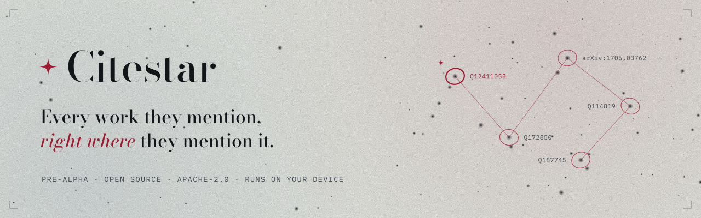

<picture>
  <source media="(prefers-color-scheme: dark)" srcset="docs/assets/banner-dark.svg">
  
</picture>

<p>
  <a href="https://github.com/citestar/citestar/actions/workflows/ci.yml"></a>
  &nbsp;<a href="README.it.md">Leggi in italiano</a>
</p>

Citestar notices the books, papers, films, series, songs, podcasts and talks named in what you read, watch or
listen to, and shows each one at the exact moment or line where it comes up. It runs on your device, needs no
account and stays out of the way.

> [!NOTE]
> **Pre-alpha.** The core primitives and the Open Citation Track schema are in place (milestone M1b); detection
> is being built. Nothing is released yet.

## Three moments

| Before you click                                                                                                                                                | While it plays                                                                                                                                       | Afterwards                                                                                                            |
| --------------------------------------------------------------------------------------------------------------------------------------------------------------- | ---------------------------------------------------------------------------------------------------------------------------------------------------- | --------------------------------------------------------------------------------------------------------------------- |
| A small count on a link or thumbnail. Hover it to see the main works and a timeline of where they fall; a point on the timeline opens the video at that second. | When a work is named, a glint appears at the edge and opens into its title, away from subtitles and controls. Nothing pauses, nothing makes a sound. | Every citation of the session in one list, with the sentence it came from, ready for Zotero, BibTeX, CSL-JSON or RIS. |

## It speaks only when it is sure

A wrong citation costs more than a missed one. A mention appears only when the expected value of showing it is
positive:

```text
show if   p·U − (1 − p)·C_fp − C_att > 0
that is   p > (C_fp + C_att) / (U + C_fp) = (3 + 0.2) / (1 + 3) = 0.80
```

`p` is the calibrated confidence, `U = 1` the value of a useful citation, `C_fp = 3` the cost of a wrong one and
`C_att = 0.2` the cost of your attention. The rest of its behaviour has numbers too:

|           |                                                                                                            |
| --------: | ---------------------------------------------------------------------------------------------------------- |
|  **0.80** | Confidence needed to appear on screen. Between 0.5 and 0.8 a work goes only into the list, marked "maybe". |
|     **2** | Citations on screen at the same time, at most.                                                             |
|  **10 s** | Average gap between new chips: a token bucket refills at 0.1 per second, up to 2.                          |
| **1.5 %** | Of the player a closed chip may cover. Opened on hover or focus, 12 % at most.                             |
|  **6 px** | What remains in fullscreen: a single point of light.                                                       |
|     **0** | Pauses, sounds and pop-ups.                                                                                |

The derivations are in [docs/MATH.md](docs/MATH.md).

## Your transcript stays with you

| Stays on your device                                   | Leaves it                                                                                                           |
| ------------------------------------------------------ | ------------------------------------------------------------------------------------------------------------------- |
| The pages you read and the subtitles of what you watch | The mention alone, such as `Sapiens`, sent to open catalogs like Wikidata and Open Library                          |
| The transcription of audio, never stored               | Only if you opt in to the shared cache: the first bits of a hashed address, answered with at least 50 other entries |
| Detection and scoring of every mention                 |                                                                                                                     |
| Your saved list of works                               |                                                                                                                     |

No account, no telemetry, no affiliate links.

## Open Citation Track

Creators and publishers can list the works they cite once, with the second or the sentence where each one
appears. Citestar trusts these tracks over its own guesses and marks them as verified. Works are identified by
Wikidata, so the same book has the same identity in every language.

```json
{
  "specVersion": "0.1.0",
  "works": [
    {
      "id": "wikidata:Q12411055",
      "type": "book",
      "title": "Sapiens",
      "authors": ["Yuval Noah Harari"],
      "year": 2011
    }
  ],
  "mentions": [
    {
      "surface": "Sapiens",
      "anchor": { "kind": "time", "start": 312.4, "end": 313.6 },
      "workId": "wikidata:Q12411055",
      "p": 0.94,
      "source": "creator"
    }
  ]
}
```

The draft schema, examples and rules are in [spec/](spec/).

## Roadmap

|     | Milestone                                                                              | Status                |
| --- | -------------------------------------------------------------------------------------- | --------------------- |
| M0  | Research: catalogs, platform terms, prior art, the name                                | Done                  |
| M1  | Core pipeline: detection, linking to Wikidata, calibration, a gold set of 500 mentions | **In progress** (M1b) |
| M2  | Interface and demo: chips, cards and the constellation, on articles, PDFs and video    | Next                  |
| M3  | Browser extension for Chrome, Edge and Firefox: articles, PDFs, YouTube                | Planned               |
| M4  | Speech recognition on device for videos without subtitles; vertical video              | Planned               |
| M5  | One-line embed, the published standard, a self-hosted cache                            | Planned               |
| M6  | Launch: extension stores, documentation, Italian and English                           | Planned               |

## Repository

```text
packages/core   DOM-free pipeline: model, normalization, similarity, calibration statistics
spec/           Open Citation Track: JSON Schema, examples, rules
tools/          Build and repository checks, brand assets
docs/           Research, decisions, architecture, math
```

Requires Node.js 26 and Corepack. Then:

```sh
pnpm install
pnpm check      # format, lint, typecheck, build, packed-package check, tests with coverage
```

Full setup, including how to verify the Node.js download, is in [docs/SETUP.md](docs/SETUP.md).

## Documentation

- [Architecture](docs/ARCHITECTURE.md): the pipeline and the packages
- [Math](docs/MATH.md): every formula, with derivations
- [Decisions](docs/DECISIONS.md): what we chose and why
- [Research notes](docs/RESEARCH.md): APIs, platform terms, libraries and models
- [Landscape](docs/LANDSCAPE.md): similar products and how Citestar differs

## License

[Apache-2.0](LICENSE). Built on open catalogs: Wikidata, Open Library, Crossref, OpenAlex, MusicBrainz and arXiv.
