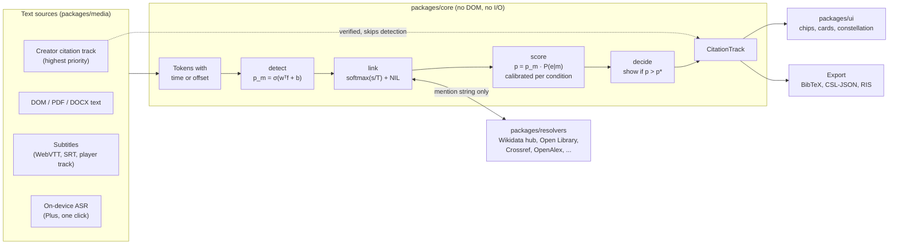

# Architecture

_Status as of M1b: the core primitives exist (model, validation, normalization, similarity, softmax,
statistics). Everything else below is the plan._

## Pipeline

The core is a set of pure functions: it receives text with positions and candidate works, and returns a
citation track. All I/O (network, storage, media) lives in other packages and is injected. This keeps the core
testable without mocks and lets it run unchanged in the extension, the embed script and the server.

## Packages

| Package              | Role                                                          | Status |
| -------------------- | ------------------------------------------------------------- | ------ |
| `packages/core`      | Data model, detection, linking, scoring, decision, statistics | M1b–e  |
| `packages/resolvers` | Catalog plugins with cache, token bucket, retry with backoff  | M1d    |
| `packages/media`     | Text and time from subtitles, ASR, OCR, PDF, DOCX             | M2–M4  |
| `packages/ui`        | Lit web components, analytic spring engine, themes            | M2     |
| `packages/embed`     | One-line script, React and Vue wrappers                       | M5     |
| `packages/extension` | Browser extension (WXT, Manifest V3)                          | M3     |
| `packages/server`    | Optional self-hosted API (Hono), opt-in shared cache          | M5     |
| `spec/`              | Open Citation Track: JSON Schema and examples                 | M1b    |
| `eval/`              | Gold set annotations (CC BY-SA 4.0) and metric scripts        | M1f    |
| `tools/`             | Build and repository checks (neutral build, purity tests)     | M1a    |

## Core modules (M1b)

| Module                 | Exports                                                    |
| ---------------------- | ---------------------------------------------------------- |
| `model.ts`             | `CitationTrack`, `Work`, `Mention`, `Anchor`, `WORK_TYPES` |
| `validate.ts`          | `validateTrack`: rules JSON Schema cannot express          |
| `text/normalize.ts`    | `normalizeTitle`                                           |
| `text/jaro-winkler.ts` | `jaro`, `jaroWinkler`                                      |
| `math/softmax.ts`      | `softmax`, `logSumExp`                                     |
| `stats/wilson.ts`      | `wilsonInterval`                                           |
| `stats/ece.ts`         | `expectedCalibrationError`, `equalMassBins`                |
| `stats/bootstrap.ts`   | `bootstrapInterval`, `quantile`                            |
| `stats/random.ts`      | `mulberry32` (seeded PRNG for reproducible evaluation)     |

## Platform independence

`@citestar/core` must run in browsers, workers and Node. Three guards enforce it (see
[DECISIONS.md D12](DECISIONS.md#d12--purity-guards-for-platform-independent-packages-2026-11-23)): a tsconfig
without DOM or Node types, an esbuild build for the `neutral` platform with a dependency allowlist, and ESLint
rules against platform globals.
